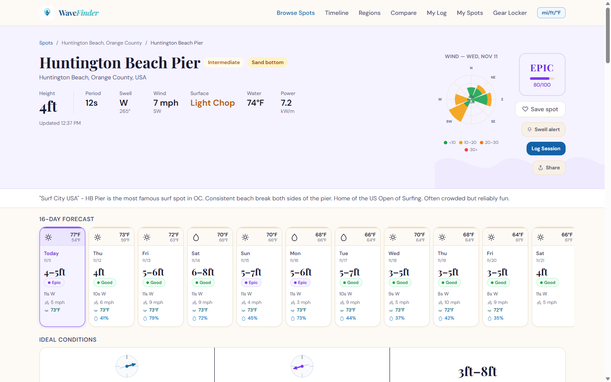
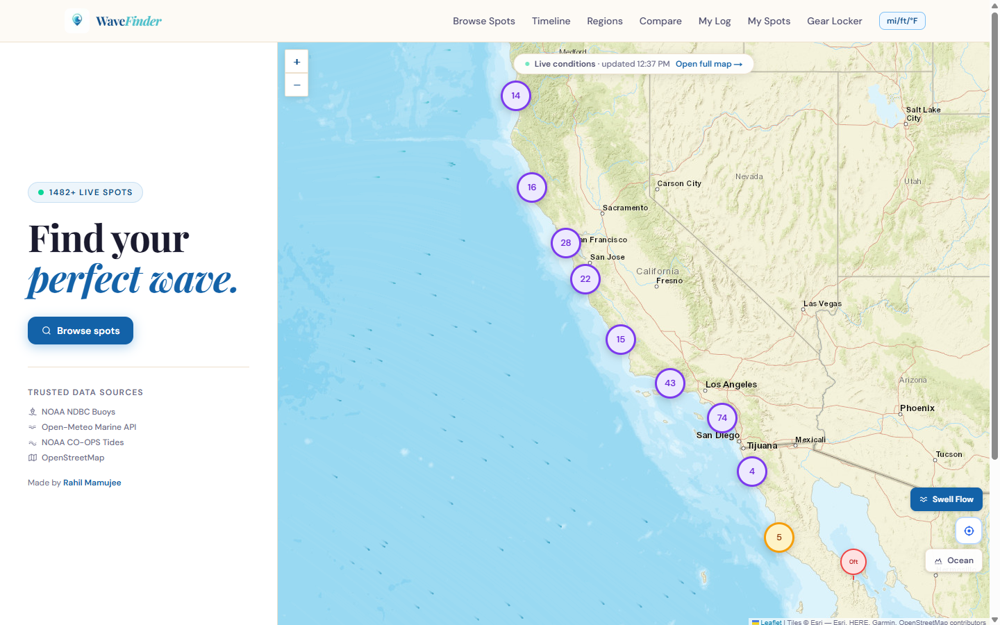

# WaveFinder

**Live: [wave-finder.vercel.app](https://wave-finder.vercel.app)**

Free surf forecasts for ~1,480 surf spots worldwide, with no account needed.
WaveFinder combines free public ocean data (NOAA buoys, NOAA tides, harmonic
tide constituents, Open-Meteo marine forecasts and the NOAA WaveWatch III
model) into a 16-day forecast and a surf rating for every spot.





**Highlights**

- **Physics-based surf rating.** Scores each swell train separately, shoals it
  by period (Komar & Gaughan), reduces it by the spot's exposure to the swell
  direction, and blends in live buoy observations, wind, gusts and tide.
  Veto caps stop a big swell from rating "good" under a 40 km/h onshore wind.
- **Worldwide tides with validation.** NOAA covers only the US, so every other
  spot gets a harmonic tide station computed offline. Picking the nearest
  station was wrong 31% of the time (river and slough gauges), so a script
  checks each assignment against a reference model before accepting it.
- **A world map that stays within free-tier budgets.** Zoomed out, the map
  reads from a daily cron that pulls the gridded WaveWatch III model (12
  requests for the whole planet) into the Vercel Runtime Cache, falling back
  to sampled Open-Meteo data. An animated swell-flow layer is drawn on top.
- **Production hygiene.** 29 Vitest test files, CI (lint with zero warnings,
  typecheck, tests, build), rate limiting, an uptime workflow, and written
  security/performance audits in [`docs/audit/`](./docs/audit/).

**Stack:** Next.js 16 (App Router), React 19, TypeScript, Tailwind CSS v4,
Prisma + Postgres, Upstash Redis, Leaflet, Recharts, TanStack Query, Vitest,
Vercel (cron + Runtime Cache)

---

## Getting started

Node 22 is required (see [`.nvmrc`](./.nvmrc)).

**1. Install dependencies:**

```bash
npm install
```

**2. Set up environment variables:**

Copy `.env.example` to `.env.local` and fill in the values:

```bash
cp .env.example .env.local
```

At minimum, you need `DATABASE_URL`, `DIRECT_URL`, `BETTER_AUTH_URL`,
`BETTER_AUTH_SECRET`, and `NEXT_PUBLIC_SITE_URL`. Optional features (Stripe,
Upstash, Sentry) are enabled by setting their respective variables.

**3. Generate the Prisma client and sync the database:**

```bash
npx prisma generate
npx prisma migrate deploy   # apply committed migrations
npm run db:seed             # (optional) seed 1,490 surf spots
```

**4. Start the development server:**

```bash
npm run dev
```

Visit http://localhost:3000.

## npm scripts

| Script | Purpose |
|---|---|
| `npm run dev` | Start dev server at http://localhost:3000 |
| `npm run build` | Build for production |
| `npm start` | Run production build |
| `npm run lint` | Run ESLint (zero warnings) |
| `npm run typecheck` | Type-check with tsc --noEmit |
| `npm test` | Run Vitest once |
| `npm run test:watch` | Run Vitest in watch mode |
| `npm run db:push` | Sync schema to database |
| `npm run db:seed` | Seed 1,490 surf spots |
| `npm run db:studio` | Open Prisma Studio (DB browser) |
| `npm run db:reset` | Force-reset and reseed database |
| `npm run migrate:dev` | Create a new schema migration |
| `npm run migrate:deploy` | Run pending migrations (used in Vercel build) |
| `npm run smoke:prod` | Smoke-test the production deployment |

## Verification

Before committing or deploying:

```bash
npm run typecheck    # TypeScript check
npm run lint         # ESLint (fails on warnings)
npm test             # Vitest suite
npm run build        # Full Next.js build
```

## Deploy to production

WaveFinder is built to deploy on Vercel. Push to the `main` branch to trigger
a deploy:

```bash
git push origin main
```

Vercel runs `next build` and `prisma migrate deploy` automatically. 

**Setup steps for a new Vercel project:**

1. Set all variables from `.env.example` in Vercel's **Production** environment.
2. For `DATABASE_URL`, use the Neon **pooled** endpoint with the query string:
   ```
   ?sslmode=require&pgbouncer=true&connection_limit=1
   ```
3. For `DIRECT_URL`, use the Neon **direct** (non-pooler) endpoint.
4. Point an external uptime monitor at `/api/health`.

See [`docs/RUNBOOK.md`](./docs/RUNBOOK.md) for the full production cutover
checklist.

## Pricing model

The app is entirely free and needs no account. Auth (better-auth) and billing
(Stripe, test mode) are still in the codebase but dormant: their routes return
404 unless `ENABLE_ACCOUNTS=true`.

## Documentation

- **Architecture & design:** [`WAVEFINDER_PROJECT.md`](./WAVEFINDER_PROJECT.md)
- **Codebase notes:** [`CLAUDE.md`](./CLAUDE.md)
- **Security & ops audits:** [`docs/audit/`](./docs/audit/)
- **Production runbook:** [`docs/RUNBOOK.md`](./docs/RUNBOOK.md)
